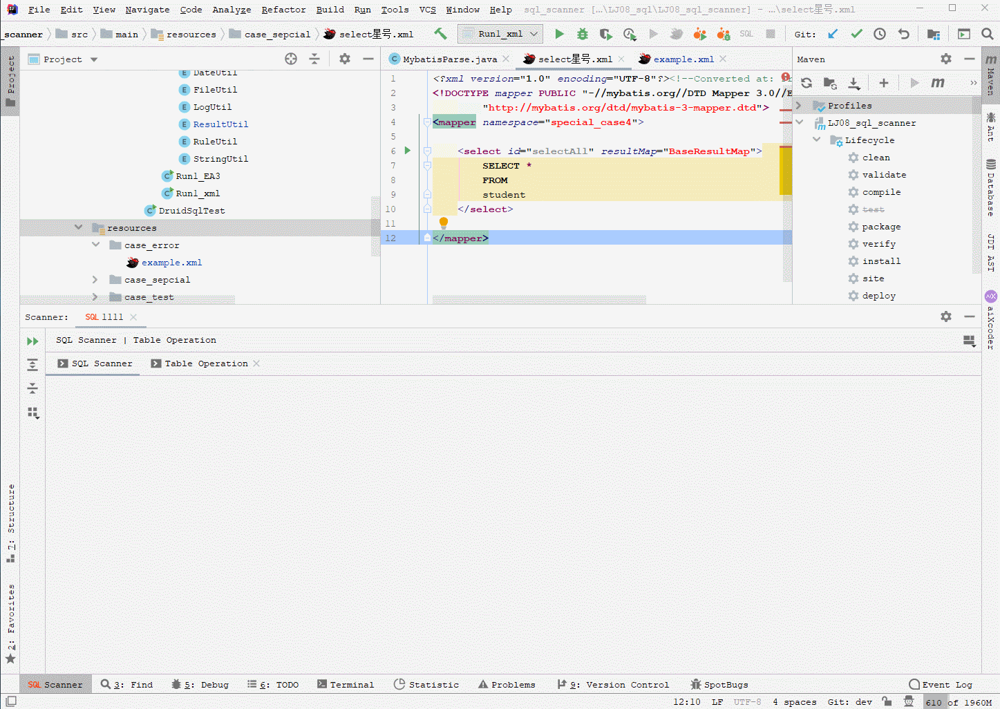
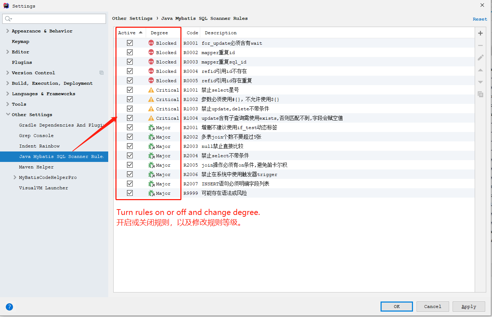

[//]:#DisplayInOneLine

### Java Mybatis SQL Scanner
This plugin can help us to scan mybatis sql xml:  
JetBrains Marketplace:[Java Mybatis SQL Scanner](https://plugins.jetbrains.com/plugin/18661-java-mybatis-sql-scanner/)

Change the database type.
  

turn rules on or off.  
    

Ask AI: 点击预览面板的 Ask AI 按钮, 将当前 SQL(原始 XML / 格式化 SQL / SQL Type / 报错建议)交给 AI 做智能分析, 支持 DeepSeek、Qwen、Doubao、GLM、Kimi、GPT、Claude 与自定义(OpenAI 兼容协议; 需 Anthropic 协议时选择 Claude 预设并改填 URL 即可).  
回答流式输出; 思考型模型的思考过程以斜体小字实时展示、回答开始后自动折叠(点标题展开); 回答区字号可调并持久化; 同一 SQL 未换模型/语言时复用上次回答, 不重复调用. AI Language 按钮可切换 AI 回答语言(中文/英文/跟随 IDE), 与界面语言无关.  
首次使用请在 `Settings > Other Settings > Java Mybatis SQL Scanner Rules > Model Settings` 中通过 Provider 下拉框(带官方图标)选择供应商、配置 API URL / API Key / Model(选择后自动填充官方默认值, 可编辑), 并用 Test Connection 验证配置(真实调用一次, 模型名填错会提示并列出可用模型). 每家供应商独立保存一套配置, 切换后无需重新填写.

这里开源的是idea插件界面，扫描核心方法在jar包 <b>resources/libs</b>.

[Blog](https://zhangxiaofan.blog.csdn.net/)，find more~  
[博客](https://zhangxiaofan.blog.csdn.net/)，发现更多~
插件开发推荐:  
[idea plugin插件开发1——idea底部窗口(带按钮)](https://zhangxiaofan.blog.csdn.net/article/details/123093013/)  
[idea plugin插件开发2——预览代码(多窗口)](https://zhangxiaofan.blog.csdn.net/article/details/123097015/)  
[idea plugin插件开发3——可编辑表单](https://zhangxiaofan.blog.csdn.net/article/details/123097368/)  
